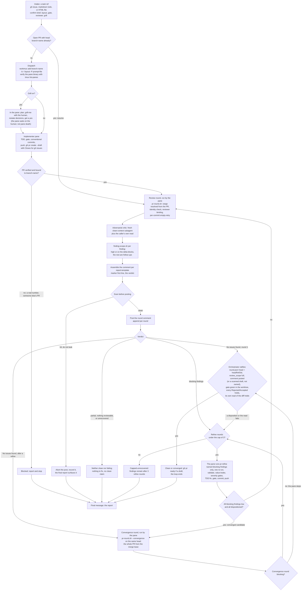
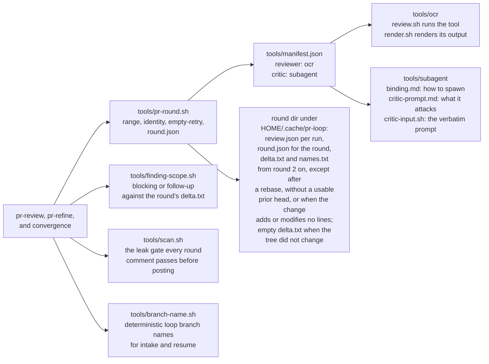

# The issue-to-PR loop: flow

One picture of the unattended loop that /issue-to-pr drives and
/pr-review and /pr-refine serve. The skills are the contract; this
diagram is the map. When the two disagree, the skills win and this file
gets fixed.

**Verdict states** (machine-read by the next round): the verdict list
in [`report-template.md`](../pr-review/report-template.md).

**Ownership:** the implementer pane runs every round (round 1, refine,
convergence). The orchestrator runs none; it ratifies.

**Loop end states** (the final message, the runner's contract): `clean`,
`converged`, `capped-unrecovered` or `blocked`, as issue-to-pr §7
([`SKILL.md`](SKILL.md)) defines each.

## The loop

## The tool slots

The process is fixed; the tools are bindings. A swap is one directory
plus one manifest line, never a skill edit.

## Where things live

| Thing | Path |
|---|---|
| Orchestrator skill | `$HOME/.claude/skills/issue-to-pr/SKILL.md` |
| Review round skill | `$HOME/.claude/skills/pr-review/SKILL.md` |
| Refine round skill | `$HOME/.claude/skills/pr-refine/SKILL.md` |
| Report template | `$HOME/.claude/skills/pr-review/report-template.md` |
| Implementer prompt | `$HOME/.claude/skills/issue-to-pr/dispatch-prompt-template.md` |
| Slot manifest and bindings | `$HOME/.claude/skills/issue-to-pr/tools/` |
| Leak gate | `$HOME/.claude/skills/issue-to-pr/tools/scan.sh` |
| Branch-name tool | `$HOME/.claude/skills/issue-to-pr/tools/branch-name.sh` |
| Round comment (read before the PR copy) | `$HOME/.cache/pr-loop/<owner/repo>/pr-<n>/round-<N>/comment.md` |
| Finding classifier | `$HOME/.claude/skills/issue-to-pr/tools/finding-scope.sh` |
| Critic prompt builder | `$HOME/.claude/skills/issue-to-pr/tools/subagent/critic-input.sh` |
| Round artifacts | `$HOME/.cache/pr-loop/<owner/repo>/pr-<n>/round-<N>/` |
| Final report | `$HOME/.cache/pr-loop/<owner/repo>/pr-<n>/final-report.md` |
| workmux layouts | `~/.config/workmux/config.yaml` (chezmoi: `dot_config/workmux/config.yaml`) |
| opencode stack agents | `~/.config/opencode/agent/sp.md`, `mp.md` (not chezmoi-managed yet) |
